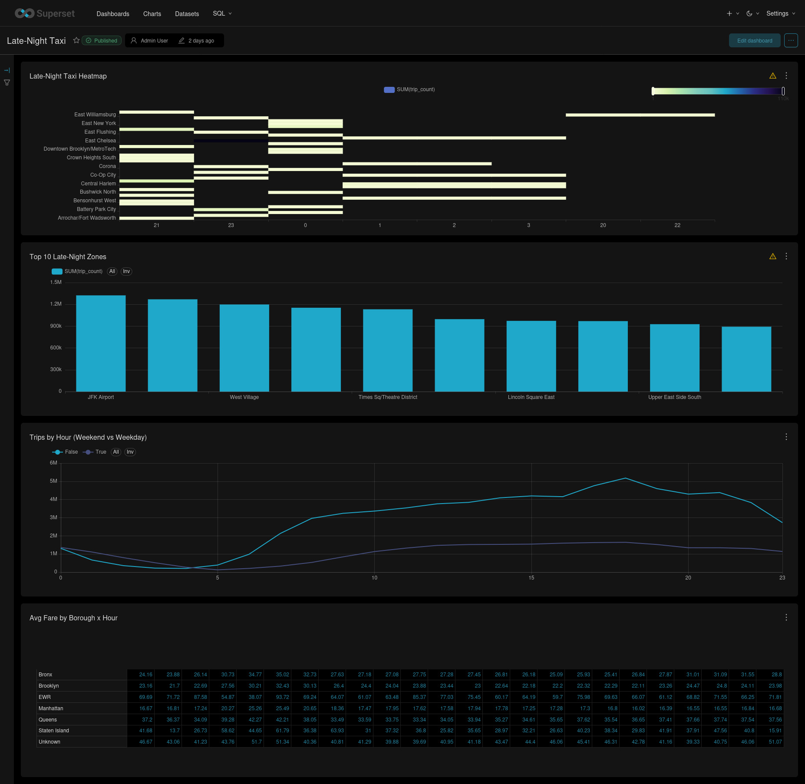
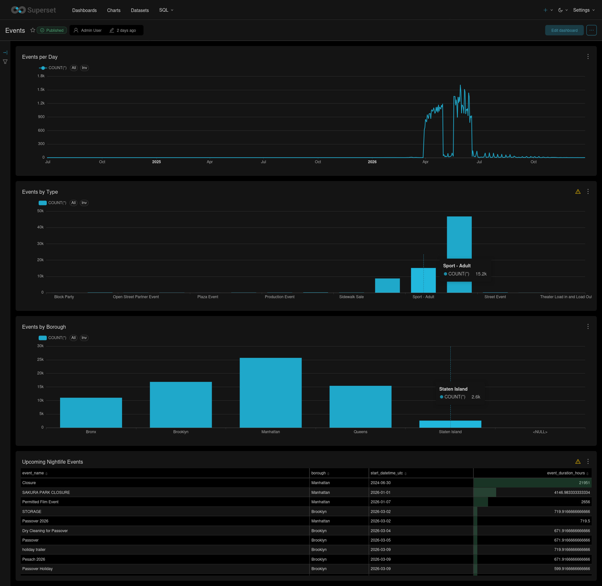
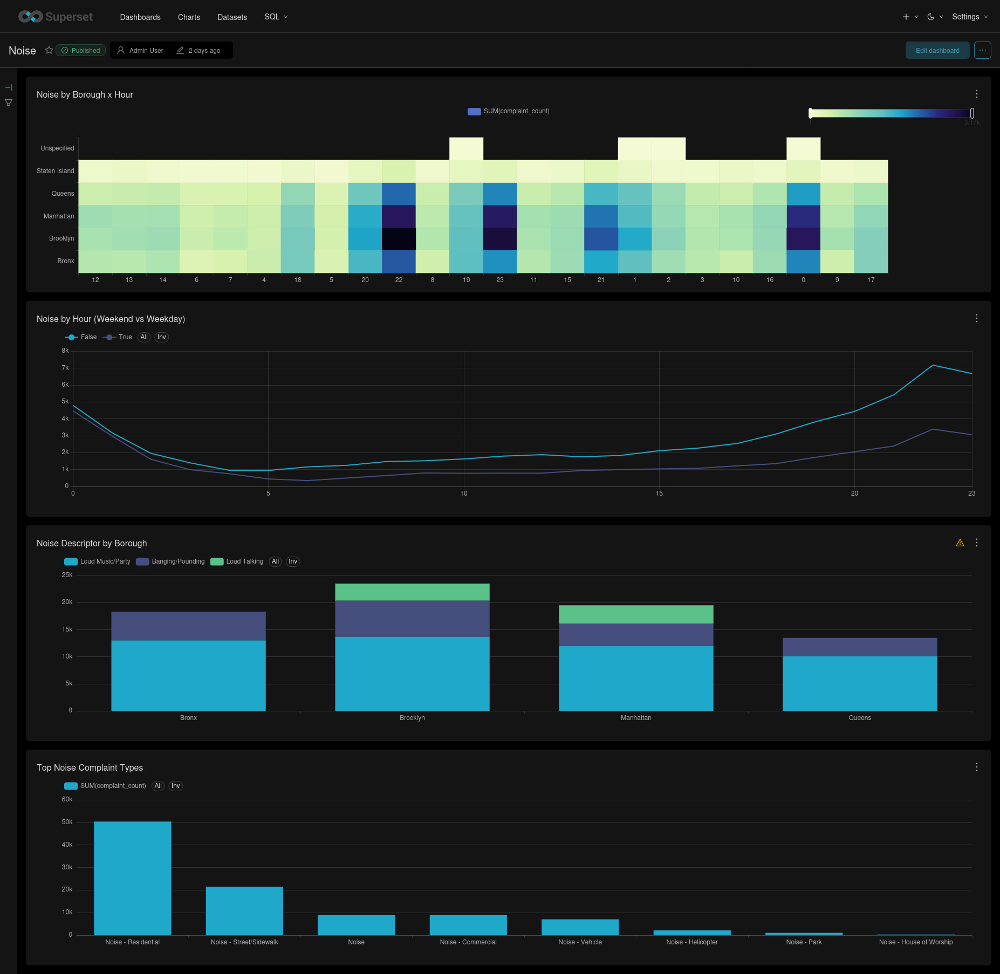
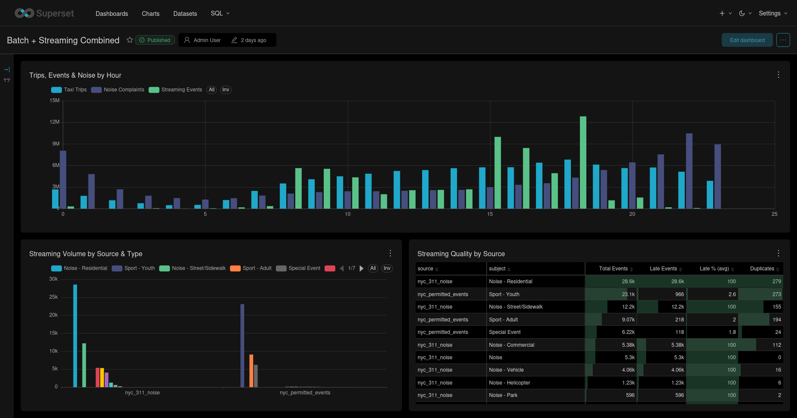
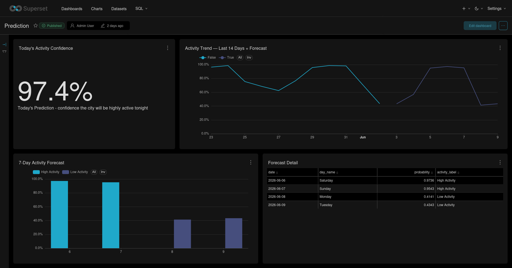

# Superset Dashboards

This document collects the five Superset dashboards used to validate the analytical layer of City Live Monitor. All dashboards query DuckDB views over Gold Parquet files, so the visuals reflect the current contents of `data/gold/` after the pipeline and bootstrap steps run.

## 1. Late-Night Taxi

Purpose: identify late-night taxi demand patterns by zone, hour, weekday/weekend split, and borough-level fare behavior.

Charts:
- Late-Night Taxi Heatmap
- Top 10 Late-Night Zones
- Trips by Hour: Weekend vs Weekday
- Average Fare by Borough x Hour

## 2. Tonight's Events

Purpose: summarize permitted events by location, type, date, and nightlife relevance.

Charts:
- Events by Borough
- Events by Type
- Events per Day
- Upcoming Nightlife Events

## 3. Live Noise Complaints

Purpose: inspect 311 noise complaint patterns by borough, hour, descriptor, and complaint category.

Charts:
- Noise by Borough x Hour
- Noise by Hour: Weekend vs Weekday
- Noise Descriptor by Borough
- Top Noise Complaint Types

## 4. Batch + Streaming Combined

Purpose: demonstrate the hybrid batch and streaming view by combining taxi demand with Kafka-derived event and noise metrics.

Charts:
- Trips, Events, and Noise by Hour
- Streaming Volume by Source and Type
- Streaming Quality by Source

## 5. Prediction

Purpose: show the daily activity classifier output, short-term forecast, and recent prediction trend.

Charts:
- 7-Day Activity Forecast
- Forecast Detail
- Activity Trend: Last 14 Days + Forecast
- Today's Activity Confidence

